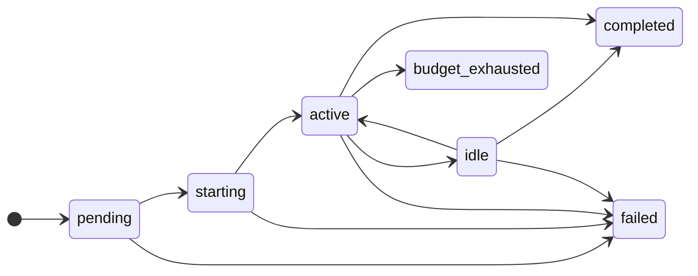

# kora — Complete Documentation

> **kora** is the control plane for AI agents. It gives every agent a verifiable identity, checks every action against policy before it runs, and brokers every credential so agents never hold secrets.

---

## Table of Contents

1. [What is kora?](#what-is-kora)
2. [Core Architecture](#core-architecture)
3. [Key Concepts](#key-concepts)
4. [System Components](#system-components)
5. [Deployment](#deployment)
6. [Code Organization](#code-organization)
6. [Development Workflow](#development-workflow)
7. [Security Model](#security-model)
8. [Testing Strategy](#testing-strategy)
9. [Frontend Architecture](#frontend-architecture)
10. [References](#references)

---

## What is kora?

kora is an open source control plane for running agent factories in production. An agent on a laptop runs with its developer's credentials and leaves no audit trail of what it did. kora makes those agents safe to run at scale.

**kora is NOT:**
- An agent framework
- A model router
- An LLM wrapper

**kora IS:**
- A platform that runs agent harnesses (Claude Code, Codex, OpenCode) on Kubernetes
- Governance layer for everything agents do
- Identity, policy, and connectivity infrastructure

### What teams build on kora

- Review and context agents that take part in every pull request
- Fleet-wide changes shipped as the same pull request to every team
- Incident agents that triage an alert and start root cause analysis before anyone is paged
- Bug-hunting agents that run weekly and explore your applications and codebases
- General purpose coding agents that pick up work from your task or issue boards

---

## Core Architecture

The architecture is organized around **three questions**:

1. **Who is this agent?** — Identity, shared by humans and agents
2. **What can it access?** — Policy, evaluated before an action executes
3. **How does it connect?** — Connectivity, brokered so credentials are injected just-in-time

### System Context

```
┌─────────────────────────────────────────────────────────────────┐
│                        EXTERNAL CLIENTS                          │
│  (Users, CI/CD, Webhooks, External Systems)                     │
└─────────────────────────────┬───────────────────────────────────┘
                              │
                              ▼
┌─────────────────────────────────────────────────────────────────┐
│                      INGRESS GATEWAYS                            │
│  ┌─────────────────────┐    ┌─────────────────────────────┐    │
│  │   Backend API       │    │   Dashboard (Frontend + BFF) │    │
│  │   (Identity svc)    │    │                             │    │
│  └─────────────────────┘    └─────────────────────────────┘    │
└─────────────────────────────┬───────────────────────────────────┘
                              │
              ┌───────────────┼───────────────┐
              ▼               ▼               ▼
       ┌────────────┐  ┌────────────┐  ┌────────────┐
       │  Policy    │  │  Identity  │  │  Connectivity │
       │  Service   │  │  Service   │  │  (Inference,  │
       │            │  │            │  │   MCP, Egress)│
       └────────────┘  └────────────┘  └────────────┘
              │               │               │
              └───────────────┼───────────────┘
                              ▼
┌─────────────────────────────────────────────────────────────────┐
│                    CONTROL PLANE (kora-system)                   │
│  ┌────────────┐ ┌────────────┐ ┌────────────┐ ┌────────────┐   │
│  │ kora-agents│ │kora-triggers│ │  Operator  │ │  session-  │   │
│  │            │ │            │ │            │ │  manager   │   │
│  └────────────┘ └────────────┘ └────────────┘ └────────────┘   │
└─────────────────────────────┬───────────────────────────────────┘
                              │
              ┌───────────────┼───────────────┐
              ▼               ▼               ▼
       ┌────────────┐  ┌────────────┐  ┌────────────┐
       │  Agent     │  │  Sandbox   │  │  Egress    │
       │  Runtime   │  │  Pods      │  │  Gateway   │
       │  Pods      │  │            │  │            │
       └────────────┘  └────────────┘  └────────────┘
```

### Deep Dives

| Area | Document |
|------|----------|
| Runtime Topology | [docs/architecture/runtime-topology.md](architecture/runtime-topology.md) |
| Identity | [docs/architecture/identity.md](architecture/identity.md) |
| Policy | [docs/architecture/policy.md](architecture/policy.md) |
| Connectivity | [docs/architecture/connectivity.md](architecture/connectivity.md) |
| Inference Gateway | [docs/architecture/inference-gateway.md](architecture/inference-gateway.md) |
| Agent Execution | [docs/architecture/agent-execution.md](architecture/agent-execution.md) |
| MCP Tool Gateway | [docs/architecture/mcp-tool-gateway.md](architecture/mcp-tool-gateway.md) |
| Egress Gateway | [docs/architecture/egress-gateway.md](architecture/egress-gateway.md) |
| Policy Plane | [docs/architecture/policy-plane.md](architecture/policy-plane.md) |

---

## Key Concepts

### Runs and Sessions

A **run** is a single unit of work performed by an agent. Runs are durable and work in the background. A run can take minutes or hours, preserves its history as a durable log, and can be observed by anyone with access while it completes its task.

A **session** is the live agent working on a run. The session only exists while the agent is running, and everything it does is recorded against the run.

#### Run States



| State | Meaning | Moves to |
|-------|---------|----------|
| `pending` | Waiting for the agent to have capacity | `starting` when capacity frees, or `failed` after 180 seconds |
| `starting` | Starting its session | `active`, or `failed` if it never finishes starting |
| `active` | The agent is working | `idle` when agent finishes turn, `completed` when exits cleanly, `failed` on error, `budget_exhausted` |
| `idle` | Agent waiting for next message | `active` on new message, `completed` after idle timeout, `failed` if agent exits unexpectedly |
| `completed` | Run ended cleanly | — |
| `failed` | Run hit unrecoverable error | — |
| `budget_exhausted` | Run reached its budget limit | — |

An `idle` run is healthy. Its session stays alive waiting for the next message until the idle timeout completes the run:
- 20 minutes for a run a person started
- 5 minutes for a run a trigger started

A person who messages a triggered run moves it onto the 20 minute timeout.

#### Working with a Run

| Action | When | Who |
|--------|------|-----|
| Send a message | While run is `active` or `idle` | Anyone with access. For delegated agents, only the person who started it. |
| Interrupt | While run is `active` | Same people who can send a message |
| Terminate | Any state before run ends | Anyone with access. For delegated agents, the person who started it or someone who can read every delegated run. |

When a run ends, its sandbox and anything installed or cached inside it are deleted.

### Sandboxes

A sandbox is an isolated pod that an agent provisions for its run when a task needs compute or tooling beyond its runtime (building and testing code). Each sandbox is created from an **environment definition**.

#### Environment Definition Components

1. A sandbox image
2. Configured system resources
3. Optional connectivity and egress

> **Note**: Runs that only use MCP servers do not need a sandbox and can complete their task inside the agent's runtime pod.

#### Sandbox Lifecycle

| Tool | What it does |
|------|--------------|
| `list_environments` | Lists the environments the agent can use |
| `provision_sandbox` | Starts a sandbox in one of them |
| `replace_environment` | Switches to another environment when the task changes |

Each run has at most one sandbox at a time. The sandbox is ephemeral and deleted when the run ends or is terminated.

#### Built-in Sandbox Images

| Image | Includes |
|-------|----------|
| `kora-base` | Common CLI tools, Go, Python and uv |
| `kora-go` | `kora-base` plus golangci-lint, buf and protoc |
| `kora-node` | `kora-base` plus Node LTS and pnpm |
| `kora-python` | `kora-base` plus ruff and pytest |

Custom sandbox images must be built on `kora-sandbox-base`, validated by the kora operator.

#### Sandbox Warming

Mark an image as `warm` to pre-pull onto every sandbox node so new sandboxes start without waiting for image download.

---

### Identity

In kora, every agent has its own identity and is a first-class citizen. Agent and human identity follow fundamentally different shapes, but both get issued the same shaped platform tokens by kora.

#### Autonomous vs Delegated Agents

| | Autonomous | Delegated |
|---|---|---|
| Acts as | Itself | The person who started the run |
| Access | What the agent has been granted | Intersection of agent's access and person's access |
| Started by | Triggers, API, or person with access | A person only |
| Budget | The agent's | The person's AND the agent's |
| Runs attributed to | The agent | The person who started the run |
| Who can steer a run | Anyone with access | Only the person who started it |

#### Autonomous Agents

Run fully dark, without a person attached. Started by triggers from webhooks, queues, schedules, or the API. Governed only by their own identity, budget, and granted access. Creating/changing an autonomous agent requires holding every scope the agent would hold.

#### Delegated Agents

For work a person hands down to an agent. The agent works with that person's access and can never do more than they can. Every delegated run is attributed to the person who started it and consumes that person's budget. Delegated agents can only be started by a person, and only that person can steer the run.

#### Identity Flow

```
SPIRE agent (node) → identity-proxy (sidecar) → identity service → platform JWT (15 min)
     X.509 SVID              POST /identity/exchange           derive principal
     (via CSI socket)         (Istio mTLS, SVID as XFCC)       from SPIFFE path
```

Platform services in `kora-system` make the same exchange in-process through the identity client.

---

### Connectivity

Agents reach models, tools, and external systems without ever holding a credential. Every request leaves the agent's pod through its sidecars.

| Reaches | Through | Called from | Credential held by | Granted as |
|---------|---------|-------------|-------------------|------------|
| Models | Inference gateway | Agent runtime pod | Inference gateway | `inference:<family>:<model>:use` |
| MCP servers | Tool gateway | Agent runtime pod | The MCP server | `mcp:<server>:<tool>:use` |
| Connections | Egress gateway | Sandbox | Egress gateway, minted per request | `connection:<name>:<action>` |
| Other hosts | Egress gateway | Sandbox | None | `egress:<host>:connect` |

#### Models

Every model call goes through the inference gateway. The gateway holds upstream keys for every registered inference provider. Platform teams offer models as **virtual models** — stable aliases that allow upgrading the model behind an alias or routing to another provider without affecting downstream agents/users.

Virtual models support failover between providers, regions, and models. Enterprises can route a virtual model to an existing gateway like LiteLLM or Portkey through a `compatible` endpoint.

#### MCP Servers

Platform teams register MCP servers with the tool gateway to provide access to systems agents require. The tool gateway:
- Routes every MCP call
- Serves an OAuth 2.1 protected endpoint
- Introspects each server's tools on a configurable interval
- Publishes a scope per tool (e.g., `mcp:github:create_issue:use`)
- Filters `tools/list` to only show tools the caller has access to

#### Connections

Platform teams register a connection for each external system (GitHub, Kubernetes cluster). A connection holds the credential (GitHub App key, ServiceAccount token). Every outbound request from a sandbox is intercepted and routed through the egress gateway, which:
1. Checks the agent's grant
2. Mints a just-in-time credential
3. Injects it into the request

The agent receives the response and never sees the credential.

Each connection publishes a scope for every action it supports (e.g., reading repo contents, writing PRs). Grants can be narrowed to specific resources (set of repos, single Kubernetes namespace).

---

## System Components

### Backend Binaries (`backend/cmd/`)

| Binary | Role | Local Port | Owns Tables |
|--------|------|------------|-------------|
| `identity` | **Main control-plane API**: identity, sessions, PATs, user profiles, tenant registry, JWKS | 8080 (`/api/v1`); metrics 9464 | ✅ |
| `inference-gateway` | OpenAI/Anthropic-compatible LLM gateway: chat/completions, embeddings, responses, model catalog, usage logs, analytics | 8081 (`/v1`); metrics 9464 | ✅ |
| `policy-service` | Authorization data plane (PDP/PAP): grants, roles, vocabulary, route-scope store; compiles & serves OPA bundles | 8083 (`/api/v1`); metrics 9464 | ✅ |
| `policy-gateway` | In-app authorization API (PEP): `/policy/check`, `/query`, `/scopes`, `/explain`, `/simulate` | 8084 (`/v1`); metrics 9464 | none |
| `egress-gateway` | JIT credential broker: intercepts agent outbound calls and injects scoped external credentials | 8085; metrics 9464 | none |
| `kora-mcp` | Platform-management MCP server: exposes kora's own APIs as governed MCP tools | 8095; metrics 9464 | none |
| `tool-gateway` | Governed MCP/tool gateway: server catalog, per-tool scope enforcement, OAuth + consent, introspection | 8096 (`/v1`); metrics 9464 | ✅ |
| `kora-agents` | Agent control plane: agent-type registry, run/session lifecycle, event streaming, k8s orchestration | 8080 (in-cluster); metrics 9464 | ✅ |
| `kora-triggers` | Triggers: inbound webhook ingestion, trigger management API, cron scheduler, manual fire | 8097; metrics 9464 | ✅ |
| `session-manager` | Per-tenant StatefulSet that runs the Claude Code subprocess per session/run | 8090; metrics 9464 | none |
| `operator` | Kubernetes operator: reconciles Tenant/Platform CRDs, renders Helm/Istio, mutating pod webhook | health 8081, webhook 9443 | none |
| `identity-proxy` | Envoy `ext_proc` gRPC sidecar: injects platform Bearer tokens into agent outbound calls | unix socket; health 9090 | none |
| `sandbox-exec` | gRPC exec server inside a sandbox pod: streams stdout/stderr/exit for commands | gRPC 50051 | none |
| `kora-runtime-mcp` | MCP server (stdio) spawned by agent CLI: exposes `list_environments`, `provision_sandbox`, `replace_environment` | stdio | none |
| `kora-shell` | `$SHELL` shim in agent container: execs local bash or streams `-c` commands to sandbox pod | none | none |
| `kora-session-runner` | Wrapper that applies Landlock, then `exec()`s the agent CLI | none | none |
| `sandbox-mount` | Privileged node agent (DaemonSet): exports each sandbox's local working folder via NFS | NFS 20490 | none |
| `migrate` | Schema migrations: embeds every service's migrations, runs as chart's pre-install/pre-upgrade hook Job | none | none |
| `example` | Reference implementation demonstrating patterns (not production) | 8081 | ✅ |

> **Note**: There is NO `cmd/kora` binary; the main API is `cmd/identity`.

### Agent Pod Anatomy

```
┌─────────────────────────────────────────────────────────────┐
│                    AGENT RUNTIME POD                         │
│  ┌──────────────┐ ┌──────────────┐ ┌──────────────┐        │
│  │  session-    │ │ kora-session │ │ kora-runtime │        │
│  │  manager     │ │ -runner      │ │ -mcp         │        │
│  └──────────────┘ └──────────────┘ └──────────────┘        │
│        │               │               │                     │
│  ┌──────────────┐ ┌──────────────┐ ┌──────────────┐        │
│  │   kora-shell │ │  istio-proxy │ │ identity-proxy│       │
│  └──────────────┘ └──────────────┘ └──────────────┘        │
│                              │                               │
│                       ┌──────────────┐                        │
│                       │     OPA      │                        │
│                       └──────────────┘                        │
└─────────────────────────────────────────────────────────────┘
```

### Feature Packages (`backend/internal/`)

| Package | Owns |
|---------|------|
| `identity` | Sessions, refresh tokens, PATs, user profiles, JTI blocklist, tenant registry, principal extraction |
| `inferencegw` | Inference router, providers, catalog, usage, analytics, virtual models; OpenAI/Anthropic/embeddings/responses handlers |
| `agents` | Agent control plane: types, runs, sessions, pubsub, k8s, authz; sub-packages `sandbox/`, `sessionmanager/` |
| `policyservice` | Authz data plane; sub-packages `api/`, `bundle/`, `grants/`, `principalroles/`, `roles/`, `routes/`, `tenantbudget/`, `vocabulary/` |
| `policygw` | Policy-gateway HTTP transport (delegates evaluation to policy-service) |
| `operator` | K8s reconciliation: tenant/platform controllers, Helm render, Istio templates, pod webhook, projection of declared resources |
| `identityproxy` | `ext_proc` server, token cache, refresh loop |
| `credentials` | JIT credential broker behind `egress-gateway`; adapters (`githubapp`, `k8sbearer`, `passthrough`) |
| `toolgateway` | Governed MCP/tool gateway behind `tool-gateway`: server catalog, MCP controller, OAuth controller, introspector |
| `example` | Reference implementation, not production |
| `errors` | Empty placeholder directory |

---

## Deployment

kora is deployed as **two Helm charts**:

1. `kora-crds` — Installs custom resources
2. `kora` — Installs operator, cluster-scoped identity and gateway resources, platform services

### Prerequisites

- **Kubernetes**: 1.34–1.36 (charts require 1.34+)
- **Cluster-admin** access for initial installation
- **CNI** enforcing Kubernetes NetworkPolicy
- **StorageClass** for agent workspace volumes (ReadWriteMany for sandbox node pools)
- **LoadBalancer** for default gateway (or NodePort/ClusterIP alternative)
- **Pod Security Admission** admitting privileged SPIRE/Istio components

### Required Infrastructure

| Component | Version | Notes |
|-----------|---------|-------|
| Istio | 1.30–1.31 | Sidecar mode, CNI enabled, trust domain must match kora's |
| SPIRE | 1.15.3 (chart 0.30.2) | SPIFFE CSI driver, ClusterSPIFFEID CRD, agent SDS enabled |
| PostgreSQL | 14–18 | Reachable from system namespace; kora applies own schema via migration hook |
| Redis | — | Reachable from system namespace; TLS on by default |

### Installation Paths

| Path | When |
|------|------|
| Reference Helmfile | Blank cluster; installs SPIRE, Istio, both kora charts |
| Direct Helm | SPIRE and Istio already running |
| Argo CD | GitOps; app-of-apps with sync waves |

### Quick Start (Direct Helm)

```bash
# 1. Create and label namespace
kubectl create namespace kora-system
kubectl label namespace kora-system \
  istio-injection=enabled \
  pod-security.kubernetes.io/enforce=restricted \
  pod-security.kubernetes.io/warn=restricted \
  pod-security.kubernetes.io/audit=restricted

# 2. Install CRDs
helm upgrade --install kora-crds oci://ghcr.io/runkora/charts/kora-crds \
  --namespace kora-system

# 3. Install kora (with values file)
helm upgrade --install kora oci://ghcr.io/runkora/charts/kora \
  --namespace kora-system \
  --values kora.yaml
```

### Required Secrets (in `kora-secrets`)

| Key | Purpose |
|-----|---------|
| `DB_PASSWORD` | PostgreSQL password |
| `REDIS_PASSWORD` | Redis password |
| `KORA_TOKEN_SIGNING_KEY` | RSA private key for platform tokens |
| `KORA_TRIGGERS_ENCRYPTION_KEY` | Base64-encoded 32-byte key for trigger credentials |

### Configuration Highlights

```yaml
global:
  trustDomain: example.com      # required; equal to Istio and SPIRE
  imageRegistry: ghcr.io/runkora

frontendHost: example.com       # required; api.<frontendHost> is API host

config:
  db:
    host: postgres.example.internal
    port: 5432
    name: kora
    user: kora
  redis:
    host: redis.example.internal
    port: 6379

networkPolicy:
  enabled: true
  externalServices:
    - cidr: 10.20.0.0/24
      ports: [5432, 6379]

gateway:
  create: true
  tls:
    enabled: true
    credentialName: kora-gateway-tls
```

---

## Code Organization

### Big Picture

```
kora/
├── backend/
│   ├── cmd/                    # Deployable binaries (one per service)
│   │   ├── identity/
│   │   ├── inference-gateway/
│   │   ├── policy-service/
│   │   ├── policy-gateway/
│   │   ├── egress-gateway/
│   │   ├── kora-mcp/
│   │   ├── tool-gateway/
│   │   ├── kora-agents/
│   │   ├── kora-triggers/
│   │   ├── session-manager/
│   │   ├── operator/
│   │   ├── identity-proxy/
│   │   ├── sandbox-exec/
│   │   ├── kora-runtime-mcp/
│   │   ├── kora-shell/
│   │   ├── kora-session-runner/
│   │   ├── sandbox-mount/
│   │   ├── migrate/
│   │   └── example/
│   │
│   ├── internal/
│   │   ├── platform/           # Cross-cutting infrastructure (never imports features)
│   │   │   ├── api/            # Mux, Controller interface, JSON/error helpers
│   │   │   ├── brand/          # Product name for user/agent-facing strings
│   │   │   ├── clients/        # Typed service-to-service HTTP clients
│   │   │   ├── config/         # YAML loaders (LoadService, MustLoadService)
│   │   │   ├── logging/        # Logger interface + implementation
│   │   │   ├── middleware/     # Request logging, tracing, scope enforcement
│   │   │   ├── observability/  # OTel TracerProvider + MeterProvider
│   │   │   ├── policy/         # OPA evaluation helpers
│   │   │   ├── storage/        # Postgres (storage.DB) + Redis (storage.RedisClient)
│   │   │   └── token/          # JWT signing/verification
│   │   │
│   │   ├── identity/           # Feature: identity & auth
│   │   ├── inferencegw/        # Feature: inference gateway
│   │   ├── agents/             # Feature: agent control plane
│   │   ├── policyservice/      # Feature: authz data plane
│   │   ├── policygw/           # Feature: policy-gateway transport
│   │   ├── operator/           # Feature: k8s reconciliation
│   │   ├── identityproxy/      # Feature: ext_proc sidecar
│   │   ├── credentials/        # Feature: JIT credential broker
│   │   ├── toolgateway/        # Feature: governed MCP/tool gateway
│   │   ├── triggers/           # Feature: triggers
│   │   ├── example/            # Reference feature
│   │   └── errors/             # Empty placeholder
│   │
│   ├── go.mod
│   └── go.sum
│
├── frontend/                   # Next.js app + Hades design system
├── charts/                     # Helm charts (platform + tenant)
├── config/dex/                 # Local Dex OIDC provider config
├── scripts/                    # Auth, setup helpers
├── secrets/                    # gitignored — local signing keys
├── docs/                       # ADRs, PRDs, guides
├── docker-compose.yml          # Backing services (Postgres + Redis + Dex + glauth)
├── Makefile
├── .env.example
├── AGENTS.md                   # AI-agent + contributor conventions
├── CONTRIBUTING.md
└── README.md
```

### Key Patterns

#### 1. HTTP Routing via `api.Controller`

No central router. Each feature implements `api.Controller`:

```go
type Controller interface {
    GroupedBy() string           // URL prefix, e.g. "/identity"
    Middleware() middleware.MiddlewareHandler
    Boot(mux *api.Mux)           // Register routes on the mux
}
```

Binary's `main.go` builds controllers and registers them.

#### 2. Dependency-Injected Logger

```go
logger := logging.NewLogger()      // production JSON logger
s.logger.Info(ctx, "session created", logging.Field{Key: "session_id", Value: id})
```

Every log call takes `ctx` first for OTel trace correlation.

#### 3. Database Access via `storage.DB`

Explicit SQL, no ORM. `storage.DB` wraps `*pgxpool.Pool`:

```go
func (r *postgresSessionRepository) Create(ctx context.Context, s *Session) error {
    _, err := r.db.Pool.Exec(ctx, `INSERT INTO identity_sessions (...) VALUES (...)`, ...)
    return err
}
```

Use `errors.Is(err, pgx.ErrNoRows)` for not-found checks.

#### 4. Service-to-Service Calls via Platform Clients

All outbound HTTP goes through typed clients in `internal/platform/clients/{service}/client.go` embedding `httpclient.Base` (handles OTel spans, W3C trace propagation, structured logging).

**Never construct `http.Client{}` directly.**

#### 5. Configuration via `config.LoadService[T]` + `base.yaml`

```go
cfg := config.MustLoadService[AppConfig]("cmd/identity", config.Environment())
```

Secrets never in YAML — tagged `yaml:"-"` and loaded via `os.Getenv`.

#### 6. Migrations via Goose (per-binary)

```bash
make migrate-create service=identity name=add_sessions_index
```

Migrations live under `backend/cmd/{service}/migrations/`. `make migrate-lint` enforces: DDL only, own tables only.

---

## Development Workflow

### PRD → ADR → Implementation

For new features and significant changes:
1. **PRD** (`docs/prd/`) — Define problem and solution
2. **ADR** (`docs/adr/`) — Capture technical approach (Context → Options → Decision → Consequences)
3. **Implementation** — Reference PRD/ADR in commits and PR

Bug fixes and minor changes skip PRD/ADR. **An ADR before significant implementation is a hard rule.**

### Local Development

```bash
make setup   # Once per machine: generate .env, install tools, git hooks, local DNS, mkcert TLS
make up      # Backing services, k3d cluster, migrations, operator, tenants, workloads
make auth    # Device Authorization Grant → dev@local.runkora.io / password
```

`make up` is idempotent — re-run whenever cluster drifts.

### Calling Authenticated APIs

```bash
# Standard pattern
TOKEN=$(jq -r '.access_token' /tmp/kora_credentials.json) && curl -sk \
  -H "Authorization: Bearer $TOKEN" \
  https://api.local.runkora.io/v1/models

# POST example (inference gateway)
TOKEN=$(jq -r '.access_token' /tmp/kora_credentials.json) && curl -sk -X POST \
  -H "Authorization: Bearer $TOKEN" \
  -H "Content-Type: application/json" \
  -d '{"model":"bedrock/claude-sonnet-4-5-20250929-v1","max_tokens":50,"messages":[{"role":"user","content":"Hello"}]}' \
  https://api.local.runkora.io/v1/chat/completions | jq .
```

Endpoints:
- Dashboard: `https://local.runkora.io`
- Backend API: `https://api.local.runkora.io`

### In-Cluster Ports

| Service | Port |
|---------|------|
| Main API (`identity`) | 8080 |
| Inference Gateway | 8081 |
| Policy Service | 8083 |
| Policy Gateway | 8084 |
| Triggers | 8097 |
| Session Manager | 8090 |

### Token Refresh

```bash
make auth-refresh   # Rotate token pair in /tmp/kora_credentials.json
```

If refresh token expired, run `make auth` for fresh session.

### Quality Gate

```bash
make check   # tidy + fmt + vet + lint + secret scan + docs-check + Hades manifest + tests + frontend checks
```

All PRs must pass `make check` with zero issues.

---

## Security Model

### Automated Enforcement (Tier 1: AST Rules)

| Rule | What it bans |
|------|--------------|
| `spanSetStatusLocalErr` | `span.SetStatus(_, err.Error())` |
| `spanSetStatusCtxErr` | `span.SetStatus(_, ctx.Err().Error())` |
| `spanAttrStringLocalErr` | `attribute.String(_, err.Error())` |
| `spanAttrStringCtxErr` | `attribute.String(_, ctx.Err().Error())` |
| `noRawJsonDecodeRequest` | `json.NewDecoder(r.Body).Decode(...)` in handlers |
| `noFmtErrorfStringErr` | `fmt.Errorf("...: %s", err)` |
| `noRawHttpClientLiteral` | `http.Client{...}` literal construction |
| `noHttpErrorInHandler` | `http.Error(w, ...)` in handlers |
| `noDirectWriteHeader` | `w.WriteHeader(code)` in handlers |
| `noProductNameLiteral` | Prose `kora`/`orbit` literal in speaking package |

### Import Bans (Tier 2: depguard)

| Rule | What it bans |
|------|--------------|
| `no-stdlib-log` | `log`, `log/slog` |
| `no-otel-span-mgmt-in-service-clients` | `otel/codes`, `otel/trace` in typed clients |
| `no-database-sql` | `database/sql` |
| `no-raw-viper` | `github.com/spf13/viper` |
| `no-raw-yaml` | `gopkg.in/yaml.v2/v3`, `go.yaml.in/yaml/v3` |
| `no-third-party-routers` | `gin`, `chi`, `echo`, `gorilla/mux` |

### Security Guidelines

- **No secrets in code**: Use environment variables or secret management
- **Validate all inputs**: Especially from external agents or tools
- **Principle of least privilege**: Grant minimum necessary permissions
- **Audit everything**: All actions must emit events to the event spine
- **Identity verification**: Never trust, always verify
- **Policy-first**: Don't implement authorization logic in business code

---

## Testing Strategy

### What Exists Today

1. **Unit tests** — Bulk of coverage, table-driven, run by `make test` (race + coverage) and `make check`. No cluster or database required.

2. **Postgres-backed repository tests** — Named `TestPostgres_*`, gated on `KORA_TEST_DB_URL`. Skip when unset. Live beside the repository they exercise.

| Package | Test Files | Covers |
|---------|------------|--------|
| `triggers` | `postgres_test.go` | Durable queue, delivery dedup, retention, admission ceiling |
| `agents` | `drafts_postgres_test.go`, `run_attribution_postgres_test.go`, `run_page_postgres_test.go`, `run_queue_postgres_test.go`, `agent_soft_delete_postgres_test.go`, `declared_postgres_test.go` | Draft CRUD, run trigger attribution, keyset run pages, scheduling queue, agent soft delete |
| `policyservice/grants` | `postgres_test.go` | Scope purging across grants |
| `policyservice/roles` | `postgres_test.go` | Scope purging across roles; CRD rows |
| `policyservice/tenantbudget` | `postgres_test.go` | CRD budget replaces API budget |
| `inferencegw` | `postgres_test.go`, `pricing_postgres_test.go`, `catalog_postgres_test.go` | Agent slug backfill, usage aggregates, price overrides, virtual model upserts |
| `example` | `postgres_test.go` | Reference repository (gated on `KORA_EXAMPLE_TEST_DB_URL`) |

Run locally:
```bash
make test-postgres   # Applies schema with cmd/migrate first
```

3. **Integration suite** — `backend/tests/integration/policy/authz_test.go` (build tag `integration`). Needs full running cluster. Run via `make test-integration`. Not run by CI or `make check`.

4. **No dedicated lint-rule unit tests** — Custom `golangci-lint` rules validated empirically via `make check`.

### Testing Principles

- Write tests alongside new code
- Unit tests are the default and must pass in `make check`
- Reach for Postgres tests when behavior lives in SQL
- A mock can only agree with whatever its author believed the SQL did

---

## Frontend Architecture

### Hades Design System

All product JSX **must** use Hades (`@runkora/hades`). Raw HTML primitives are banned by ESLint with **zero escape hatches**.

| Rule | What it bans | Use instead |
|------|--------------|-------------|
| `local/no-raw-layout-elements` | `<div>`, `<section>`, `<aside>`, `<nav>`, `<header>`, `<footer>`, `<article>`, `<main>` | `Stack`, `Grid`, or `asChild` variants |
| `local/no-raw-html-text-tags` | `<p>`, `<h1>`–`<h6>` | `Text`, `Heading` |
| `local/no-raw-inline-elements` | `<span>`, `<strong>`, `<b>`, `<em>`, `<i>`, `<code>`, `<kbd>` | `Text`, `Text weight="heavy"`, `Code` |
| `local/no-raw-interactive-elements` | `<button>` | `Button` |
| `local/no-hades-classname` | `className` on any Hades component | Component's own props |
| `local/no-direct-lucide-import` | `import { X } from 'lucide-react'` | `<Icon name="…" />` |
| `local/no-hades-disable-comment` | Any `eslint-disable` targeting a Hades rule | No escape hatch |
| `local/no-product-name-literal` | Whole word `kora` or `orbit` in strings | `useBrand().productName` or `getBrand()` |

### Common HTML → Hades Replacements

| Raw HTML | Hades |
|----------|-------|
| `<div className="flex flex-col gap-4">` | `<Stack gap="comfortable">` |
| `<div className="flex flex-row gap-2">` | `<Stack direction="horizontal" gap="snug">` |
| `<div className="grid grid-cols-3 gap-4">` | `<Grid cols={3} gap="comfortable">` |
| `<button onClick={fn}>label</button>` | `<Button onClick={fn}>label</Button>` |
| `<h1>…</h1>` | `<Heading variant="title">…</Heading>` |
| `<p>Body copy</p>` | `<Text>Body copy</Text>` |
| `<strong>…</strong>` | `<Text weight="heavy">…</Text>` |
| `<code>value</code>` | `<Code>value</Code>` or `<Text mono>` |

### Component Placement (Three-Tier Model)

| Tier | Name | Filesystem | Import | Storybook Prefix |
|------|------|------------|--------|------------------|
| **1** | Hades | `src/packages/hades/src/components/` | `@runkora/hades` | `Hades/Atoms/`, `Hades/Molecules/`, `Hades/Layout/`, `Hades/Organisms/` |
| **2** | App-level shared | `src/components/` | `@runkora/components` | `App/Atoms/`, `App/Molecules/`, `App/Organisms/` |
| **3** | Feature-scoped | `src/app/(dashboard)/[feature]/_components/` | relative import | n/a |

**Decision Tree (apply in order, stop at first match):**

1. Used by exactly one file → keep inline (extract only if host file > ~300 lines JSX)
2. All consumers within same feature area → **Tier 3**
3. Consumers span ≥2 feature areas AND no kora domain knowledge → **Tier 1 (Hades)** — requires human approval
4. Consumers span ≥2 feature areas AND kora-domain-aware → **Tier 2**

Every extracted component file must open with `@tier` JSDoc comment:

```ts
/** @tier 1 — Zero kora domain knowledge. Could be extracted to a standalone library. */

/** @tier 2 — kora-domain-aware: uses kora status tokens. Used by: dashboard overview, model-gateway. */

/** @tier 3 — model-gateway-scoped. Promote to src/components/ if a second feature needs this. */
```

### Frontend Quality Checks

Before marking any frontend task complete:
```bash
cd frontend && pnpm lint && pnpm tsc --noEmit
```
Both must pass with zero errors.

---

## References

### Key Documentation Files

| File | Purpose |
|------|---------|
| `ARCHITECTURE.md` | Platform architecture overview |
| `AGENTS.md` | AI-agent + contributor conventions |
| `CONTRIBUTING.md` | Contribution guidelines |
| `docs/code-organization.md` | Complete directory structure and package organization |
| `docs/README.md` | Documentation index |
| `docs/what-is-kora.md` | Product overview |

### ADR Index

Key architectural decisions:

- [2026-02-17] Repository pattern and code organization
- [2026-02-17] Dependency-injected logging
- [2026-02-17] Controller-based HTTP routing
- [2026-02-18] YAML file-based configuration
- [2026-03-03] Database infrastructure layer
- [2026-03-05] Unified identity model
- [2026-03-05] SPIFFE and SPIRE workload attestation
- [2026-03-05] Service mesh and network enforcement
- [2026-03-05] Scope-gated tool exposure via MCP
- [2026-03-05] Credential-aware outbound gateway
- [2026-03-19] Multi-service backend deployment structure
- [2026-03-21] OpenTelemetry observability discipline
- [2026-03-21] Envoy ext_proc sidecar token injection
- [2026-04-01] Inference gateway architecture
- [2026-04-01] Provider model catalog and alias routing
- [2026-04-14] Policy gateway and authorisation model
- [2026-04-14] Dynamic route scope registration
- [2026-04-17] Virtual model catalog and platform routing
- [2026-04-17] Inference usage logs
- [2026-04-27] Gateway-level OPA enforcement for external traffic
- [2026-05-11] Run and session lifecycle
- [2026-05-11] Agent execution infrastructure
- [2026-05-11] Orbit agents service architecture
- [2026-05-11] Sandbox provisioning and shell proxy
- [2026-05-11] Per-session home isolation
- [2026-06-04] Per-session home isolation
- [2026-06-04] Platform scope enforcement middleware
- [2026-06-06] JIT credential brokering in egress gateway
- [2026-06-10] Budget model redesign
- [2026-06-20] Extended trigger types
- [2026-06-29] MCP tool gateway
- [2026-07-22] Connection scope qualifiers
- [2026-07-23] Delegated agent identity
- [2026-09-04] Install and distribution model
- [2026-09-04] Enforcement sidecar injection and preflight
- [2026-09-10] Database migrations
- [2026-09-15] Manifest patches ConfigMap
- [2026-09-30] Agent pod egress lockdown
- [2026-10-01] CRD inference providers
- [2026-10-03] Sandbox environments
- [2026-10-06] Rendered service config files
- [2026-10-07] Bundled sandbox images
- [2026-10-08] Sandbox workspace mount
- [2026-10-12] White-labelling theme
- [2026-10-12] Run scheduling
- [2026-10-22] MCP server static credentials

Full ADR index: [docs/adr/README.md](adr/README.md)

### PRD Index

Product requirements: [docs/prd/README.md](prd/README.md)

### Guides

| Guide | Description |
|-------|-------------|
| [Deployment](guides/deployment.md) | Install kora in a Kubernetes cluster |
| [Tenants](guides/tenants.md) | Onboard a tenant |
| [Register Inference Provider](guides/register-inference-provider.md) | Connect to upstream inference providers |
| [Register MCP Server](guides/register-mcp-server.md) | Give agents governed access to tools |
| [Register Connection](guides/register-connection.md) | Give agents access to external systems |
| [OAuth Clients](guides/oauth-clients.md) | Configure clients for user authentication |
| [Policy and Roles](guides/policy-and-roles.md) | Configure roles, grants, route access |
| [Declarative Resources](guides/declarative-resources.md) | Define resources as Kubernetes CRs |
| [Advanced Customisations](guides/advanced-customisations.md) | Patch Kubernetes resources kora provisions |

### Contributing Docs

| Doc | Purpose |
|-----|---------|
| [Local Development](contributing/local-development.md) | Set up dev environment |
| [Troubleshooting](contributing/troubleshooting.md) | Diagnose common failures |
| [Backend Golden Path](contributing/backend-golden-path.md) | Add a backend feature |
| [Configuration](contributing/configuration.md) | Typed service configuration |
| [Observability](contributing/observability.md) | Instrumenting services |
| [Logging](contributing/logging.md) | Logging conventions |
| [Tracing](contributing/tracing.md) | Tracing conventions |
| [Frontend Testing](contributing/frontend-testing.md) | Frontend test workflow |
| [Frontend Docs](../frontend/docs/README.md) | Hades, component placement, state patterns |

---

## Design Principles

When contributing code or architecture:

1. **Security First** — Every component designed with security as primary concern
2. **Identity-Driven** — All actions tied to verified identities
3. **Policy-Governed** — Policies enforced _before_ execution, not after
4. **Observable** — Complete visibility: distributed tracing, structured logging, log-trace correlation
5. **Extensible** — Pluggable integrations for models, tools, identity providers
6. **Production-Grade** — Built for enterprise reliability and scale
7. **Open Standards** — OPA for policy, OIDC/SPIFFE for identity, MCP for tools, OpenTelemetry for observability

---

## License

kora is licensed under Apache License 2.0. All contributions must be compatible with this license.

---

*Generated from kora source documentation. For the latest version, see the [kora repository](https://github.com/runkora/kora).*